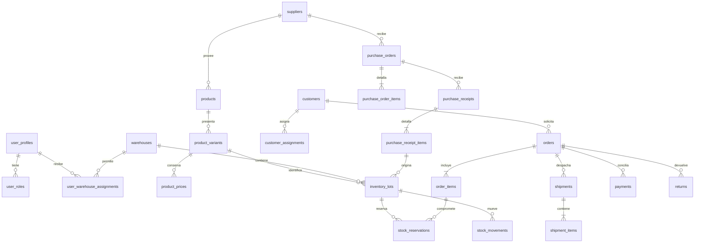

# Diseño y plan SIGDC

La especificación maestra es `especificacion-maestra.md`. Este documento distingue diseño futuro de implementación existente.

## Arquitectura
React/TypeScript/Vite → Supabase Auth y API PostgreSQL con RLS → PostgreSQL persistente. Las operaciones comerciales futuras usarán funciones transaccionales con bloqueo de filas e idempotencia; nunca cálculos de autoridad en el navegador. Edge Functions servirán para invitaciones administrativas y servicios privilegiados. Cloudflare Pages alojará únicamente los recursos públicos. No hay servicios adicionales de pago previstos.

Los roles se combinan y se consultan en base de datos en cada operación, sin depender de metadatos editables ni de roles antiguos contenidos en JWT. Los perfiles nuevos se crean desactivados y sin roles. La primera activación administrativa se realiza por un operador autorizado en SQL. Las políticas actuales protegen exclusivamente las entidades implementadas en Fase 0.

## Repositorio
- `src/`: aplicación, sesión y navegación por permisos.
- `supabase/migrations/`: cambios de esquema versionados.
- `tests/`: pruebas unitarias y SQL de seguridad.
- `docs/`: especificación, arquitectura y pendientes.

## Modelo entidad-relación previsto

Las entidades comerciales del diagrama aún no son tablas implementadas. Cada operación tendrá claves foráneas, cantidades positivas, importes numeric y fecha timestamptz; precios y costos históricos se conservarán por separado. Finanzas se aislará de las tablas accesibles a vendedores y almacenistas para evitar filtración por columnas. Las evidencias usarán buckets privados y políticas por pedido.

## Matriz de permisos objetivo
| Recurso | Administrador | Vendedor | Almacenista |
|---|---|---|---|
| Usuarios y asignaciones | Gestionar | Perfil propio | Perfil propio |
| Clientes | Todos | Solo asignados | Datos mínimos de preparación |
| Pedidos | Todos | Propios/autorizados | Preparar en almacenes asignados |
| Inventario | Todos | Disponibilidad comercial | Almacenes asignados |
| Costos, utilidad, compras y comisiones | Administrar | Sin acceso | Sin acceso |
| Entrega y evidencia | Todos | Responsable autorizado | Salida autorizada |
| Auditoría | Leer | Sin acceso | Sin acceso |

## Fases y dependencias
0. Identidad, roles, RLS y navegación. Puerta: pruebas SQL, sesión real, invitación y recuperación verificadas.
1. Organización y catálogo, clientes y administración de usuarios. Depende de identidad y aislamiento.
2. Inventario por lote, recepción y traspasos. Puerta: concurrencia, no negativos, idempotencia.
3. Pedido → reserva → despacho → entrega → devolución; sin ventas por reserva.
4. Compras y finanzas; costos históricos, pagos parciales y reglas de comisión sin valores inventados.
5. Analítica explicable y tareas programadas independientes del navegador, historial de ejecución y XLSX con permisos.
6. PWA, escaneo, accesibilidad, respaldos/restauración y aceptación completa de los 28 escenarios.

No se autoriza lanzamiento operativo antes de completar las seis fases. Ningún módulo futuro se presenta como funcional.

## Decisiones y riesgos
- Internet obligatorio; no habrá cola offline de transacciones.
- El cron y Realtime se incorporarán tras definir políticas y tablas relevantes.
- No habrá registro público. Deshabilitar signup en Supabase es una configuración obligatoria, adicional a RLS.
- La clave service_role nunca se coloca en Vite ni en archivos públicos.
- Respaldos, retención, privacidad, cuentas de infraestructura y condiciones comerciales requieren confirmación antes de producción.
- Las pruebas SQL sobre PostgreSQL con un adaptador mínimo de auth no sustituyen pruebas de Supabase Auth, correo ni navegador.
